<h1 align="center">Olá! Sou o Rafael Garcia Blanco 👾</h1>

    

  <b>Engenheiro de Software Especialista | IA, Robótica & Sistemas de Missão Crítica</b> 
  Trilíngue (Português, Espanhol, Inglês) | Focado em transformar dados complexos em soluções escaláveis.

---

### 🚀 Sobre Mim
- 💼 **Atualmente:** Engenheiro de Software Full Stack construindo sistemas de alta disponibilidade, focado em tolerância a falhas e arquiteturas complexas (RBAC).
- 🎓 **Estudando:** Pós-graduação em Robótica e Inteligência Artificial (UTEC/FURG/UNRaf) e aprofundando em Data Science.
- 🔬 **Pesquisa & Inovação:** Prototipagem de agentes de IA, visão computacional (Edge AI) e RAG aplicados a problemas reais.
- 👾 **Game Dev:** Desenvolvedor Indie utilizando Godot 4 (Shaders, IA de inimigos e design de níveis).
- 📫 **Contato:** rafael.blanco.dev@gmail.com

---

### 💻 Minha Stack Tecnológica

  <b>Backend & IA:</b> 
  
  
  
  
  

  <b>Frontend & Game Dev:</b> 
  
  
  

  <b>DevOps & Ferramentas:</b> 
  
  
  

---

### 🏆 Projetos em Destaque

🔹 <b>Sistema de Votação em Tempo Real (Missão Crítica)</b>  
&nbsp;&nbsp;&nbsp;Plataforma legislativa construída com PHP e JavaScript, garantindo 100% de disponibilidade em sessões concorrentes por meio de tolerância a falhas e dashboard em tempo real.

🔹 <b>Monitoramento Visual com Edge AI e Princípios 5S</b>  
&nbsp;&nbsp;&nbsp;Pesquisa e aplicação de visão computacional para avaliação automática de conformidade de bancadas industriais.

🔹 <b>Sistemas de Ouvidoria & Diárias (GovTech)</b>  
&nbsp;&nbsp;&nbsp;Plataformas de *accountability* financeira construídas com Laravel e SQL, implementando rigoroso Controle de Acesso Baseado em Funções (RBAC).

🔹 <b>Horde Survival Game (Godot 4)</b>  
&nbsp;&nbsp;&nbsp;Jogo indie focado no desenvolvimento de shaders avançados customizados, design de níveis e otimização de física.

---

### 📊 Estatísticas do GitHub (Foco em Backend & Lógica)

  
  <a href="https://github.com/byakurafa">
    
      <!-- "https://github-readme-stats.vercel.app/api/top-langs/?username=byakurafa&layout=compact&langs_count=6&hide=html,css,scss,blade,Rich%20Text%20Format&size_weight=0.5&count_weight=0.5&theme=tokyonight&locale=pt-br&hide_border=true" -->
  </a>

 

---

### 🎓 Educação e Certificações
- **Pós-graduação em Robótica e Inteligência Artificial** - UTEC / FURG / UNRaf (2025 - 2027)
- **Urban Data Science Summer School** - Tuscia University, Itália (2026)
- **Fundamentals of Deep Learning** - NVIDIA (2026)
- **Tecnólogo em Análise e Desenvolvimento de Sistemas** - IFSUL (2024)

---

  
  

